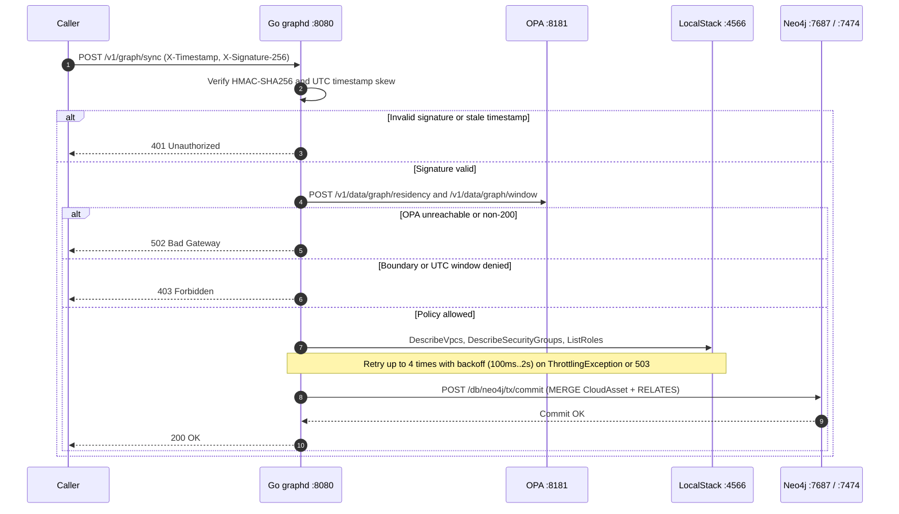
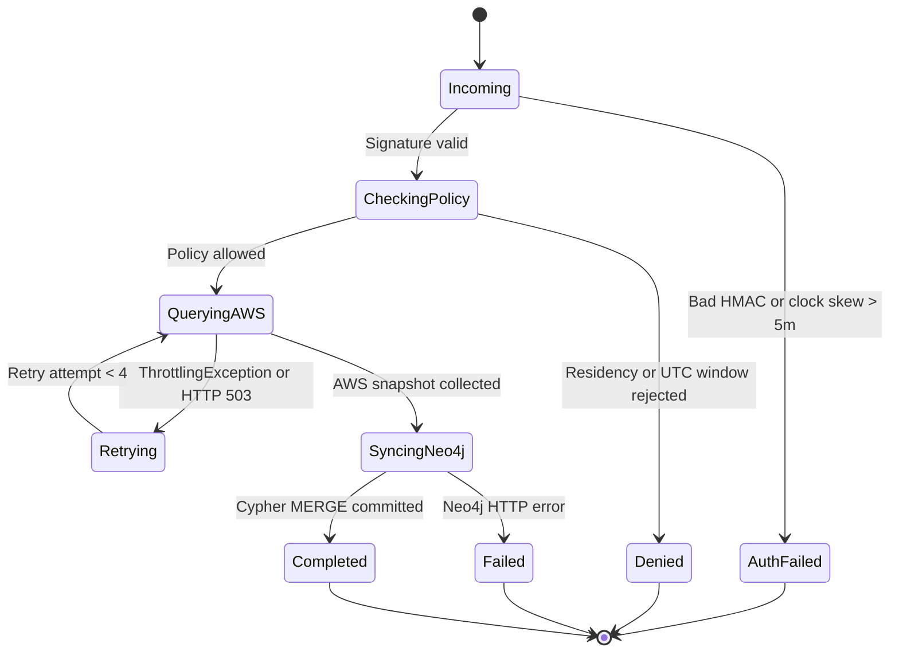

# Design Notes: AWS Cloud Asset Graph in Neo4j

This service queries AWS EC2 VPCs, EC2 security groups, and IAM roles through `aws-sdk-go-v2`, checks residency and sync-window policies in Open Policy Agent (OPA), and merges nodes and edges into Neo4j over its transactional HTTP endpoint.

## Sequence and Failure Handling

## Sync Lifecycle State Machine

## Edge Cases and Limitations

Timestamps and sync windows use UTC (`time.Now().UTC()`) so Daylight Saving Time changes do not shift allowed hours. When `incident_override.enabled` is true with an `incident_id` of at least 5 characters, off-window syncs are permitted and `lease_extension` is recorded as true on the snapshot. AWS API retries cap per-step backoff at 2s so webhook callers do not hit client read timeouts during rate-limit bursts.

Current limitations: `pushNeo4j` posts batched Cypher statements to Neo4j's HTTP transaction endpoint rather than maintaining a persistent Bolt connection pool, and `ListRoles` does not paginate beyond the initial AWS response page.
