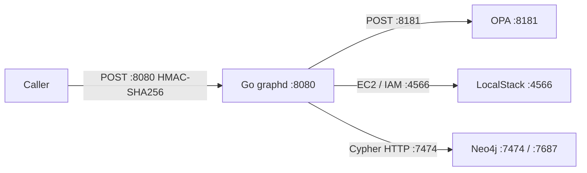

# aws-neo4j-asset-graph

Go (`1.22`) service that reads AWS EC2 VPCs, security groups, and IAM roles via `aws-sdk-go-v2`, validates boundary and UTC sync policies against Open Policy Agent (OPA), and merges asset nodes and relationships into Neo4j.

## System Topology



## Layout

```text
aws-neo4j-asset-graph/
├── cmd/graphd/           # Server entrypoint and /healthz and /v1/graph/sync routes
├── internal/
│   ├── webhook/          # HMAC-SHA256 signature and UTC replay verification
│   ├── policy/           # OPA REST client for residency and sync window checks
│   └── awsgraph/         # AWS EC2/IAM collector, retry backoff, and Neo4j sync
├── policies/             # OPA Rego files (residency.rego, sync_window.rego)
├── deploy/               # Dockerfile and docker-compose.yml (LocalStack, OPA, Neo4j)
├── tests/                # Unit, live container integration, and benchmark tests
├── DESIGN.md             # Diagrams, edge cases, and limitations
└── Makefile              # Targets: up, down, run, test, bench, lint, tidy
```

## Prerequisites

- Go 1.22+
- Docker and Docker Compose
- `curl` and `openssl`

## Local Setup and Usage

Start LocalStack, OPA, and Neo4j:

```bash
make up
```

Run the server:

```bash
make run
```

Check service health:

```bash
curl -s http://localhost:8080/healthz
```

Trigger a signed graph sync:

```bash
BODY='{"role":"infra-sre","boundary":"standard","region":"us-east-1"}'
TS=$(date -u +%s)
SIG="sha256=$(printf '%s.%s' "$TS" "$BODY" | openssl dgst -sha256 -hmac 'local-dev-graph-secret' | awk '{print $2}')"

curl -s -X POST http://localhost:8080/v1/graph/sync   -H "Content-Type: application/json"   -H "X-Timestamp: $TS"   -H "X-Signature-256: $SIG"   -d "$BODY"
```

Run tests and benchmarks:

```bash
make test
make bench
```

Stop containers:

```bash
make down
```

## Known Limitations

- Single AWS region per process (`AWS_REGION`).
- IAM `ListRoles` currently reads a single response page without `Marker` pagination.
- Neo4j writes use `/db/neo4j/tx/commit` over HTTP rather than the Neo4j Bolt driver.
